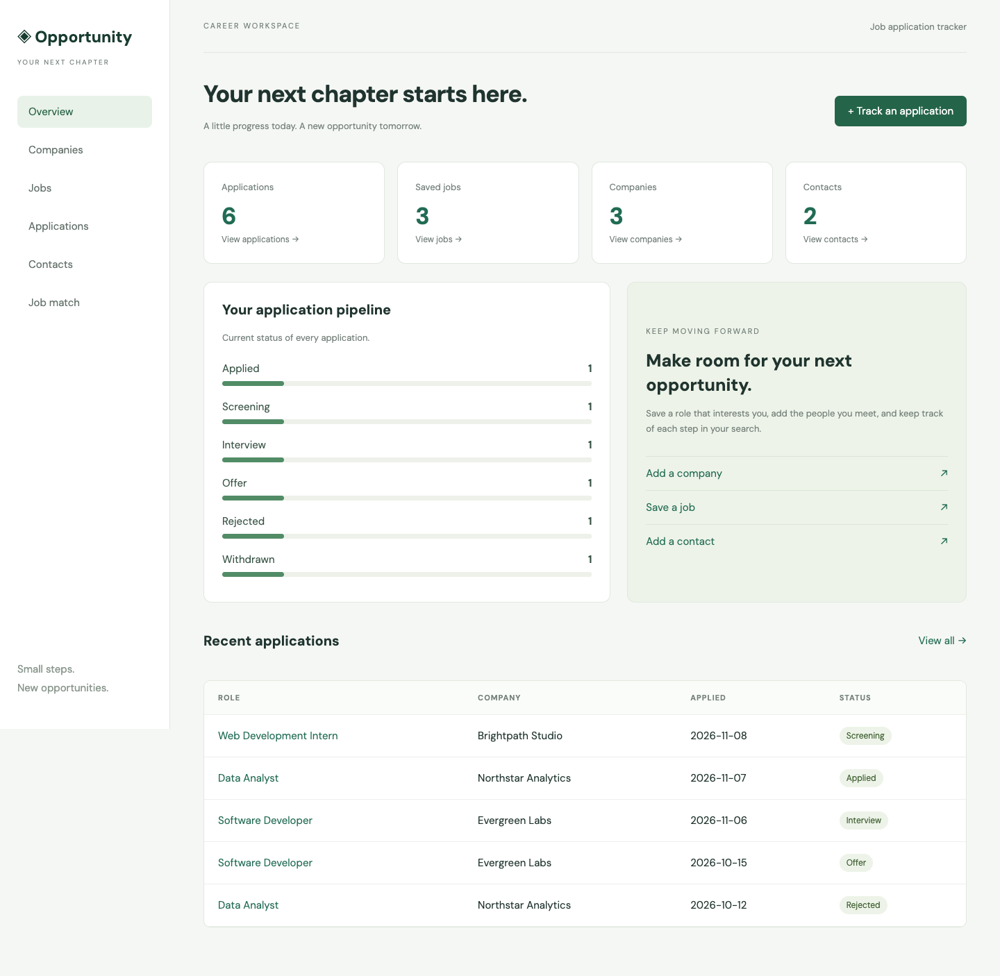

# JobTrack · Job Application Tracker

A Flask and MySQL course project for organizing companies, saved jobs, applications, and professional contacts. Includes a dashboard and a deterministic skill matching feature. Built with Python, server-rendered HTML/Jinja, custom CSS, and small JavaScript enhancements. No AI API key or paid service is required.

## Preview



[Job matching preview](docs/screenshots/job-match.png) · [Mobile dashboard preview](docs/screenshots/dashboard-mobile.png)

## Features

- Full create, list, detail, edit, and confirmed delete workflows for all four required tables.
- Companies with industry, location, website, and notes.
- Jobs with company selection, job type, salary range, posting date, URL, and required skills stored as MySQL JSON.
- Applications with six statuses, resume version, cover letter flag, and multiple interviews stored as MySQL JSON.
- Contacts with company selection, title, email, phone, LinkedIn URL, and notes.
- Searchable lists and application status filters.
- Dashboard totals, all six status counts, and the five most recent application dates.
- Job matching with ranked percentages and matched/missing skills.
- Server-side validation, parameterized SQL, CSRF protection, escaped templates, and restricted foreign-key deletion.
- Responsive navigation, tables, and forms; fictional optional demonstration data.

## Requirements

- Python 3.10 or newer (tested with Python 3.13).
- MySQL 8.0.16 or newer, with a running server. MySQL 8.4 is used by CI.
- Git and Windows PowerShell. The MySQL command-line examples below use `mysql`; add your MySQL installation's `bin` directory to the Windows `Path` environment variable if needed.

This is a local, single-user application. It does not include accounts or authentication. Keep the default loopback binding when running it for the course demonstration.

## Setup

### 1. Clone and install Python dependencies

```powershell
git clone https://github.com/elisaias-se/job_application_tracker.git
Set-Location job_application_tracker
py -m venv .venv
.\.venv\Scripts\Activate.ps1
python -m pip install -r requirements.txt
```

After activation, the prompt begins with `(.venv)`. If PowerShell prevents the activation script from running, allow local scripts for the current terminal session and try again:

```powershell
Set-ExecutionPolicy -Scope Process -ExecutionPolicy Bypass
.\.venv\Scripts\Activate.ps1
```

This policy change lasts only until that PowerShell window is closed.

### 2. Install/start MySQL

Install MySQL Server 8.0.16 or newer for Windows and include the MySQL command-line client. During configuration, keep the TCP port (normally `3306`) and set a root password that you can use during database setup.

MySQL normally runs as a Windows service. To find and start it from an **Administrator PowerShell** window:

```powershell
Get-Service -Name 'MySQL*'
Start-Service -Name 'MySQL80'
```

The service name may differ by installation; use the name shown by `Get-Service`. If `mysql` is not recognized after installation, add the MySQL `bin` folder (commonly `C:\Program Files\MySQL\MySQL Server 8.4\bin`) to the Windows `Path`, then open a new PowerShell window.

### 3. Create the database

Connect as a database administrator:

```powershell
mysql -u root -p
```

Enter the root password selected during MySQL configuration. From the MySQL prompt, with PowerShell still in the repository directory:

```sql
SOURCE schema.sql;
CREATE USER 'job_tracker'@'127.0.0.1' IDENTIFIED BY 'replace-with-your-local-password';
GRANT SELECT, INSERT, UPDATE, DELETE ON job_tracker.* TO 'job_tracker'@'127.0.0.1';
EXIT;
```

`schema.sql` creates `job_tracker` and its four tables. Run it once against a new database; it intentionally does not drop existing tables or data. If the application user already exists, use that account's existing password instead of creating it again.

Optionally load fictional demonstration records from the MySQL administrator prompt:

```sql
SOURCE seed.sql;
```

Run the seed once per demo database. It adds three companies, three jobs, six applications (one in each status), and two contacts. Repeating it adds another copy. Dates, people, and companies are fictional examples. Multiple applications to the same job represent separate demonstration attempts; the required schema does not impose a one-application-per-job rule.

### 4. Configure the application

```powershell
Copy-Item .env.example .env
python -c "import secrets; print(secrets.token_hex(32))"
```

Edit `.env`: put the generated value in `SECRET_KEY`, and set `DB_PASSWORD` to the password selected above.

```dotenv
SECRET_KEY=your-generated-secret
DB_HOST=127.0.0.1
DB_PORT=3306
DB_USER=job_tracker
DB_PASSWORD=your-local-password
DB_NAME=job_tracker
```

Keep `.env` private; it is ignored by Git. A stable secret keeps form tokens valid across server restarts. Without a configured secret, a random development secret is generated each process start.

### 5. Run

```powershell
python -m flask --app app:create_app run
```

Open **http://127.0.0.1:5000**. Stop the server with Ctrl+C. If port 5000 is busy, append `--port 5001`. `python app.py` is also supported. Debug mode is off by default.

## Using the tracker

1. Add a company.
2. Save a job and select that company. Enter required skills separated by commas.
3. Track an application and select the saved job. Update its status as the process advances.
4. Use **Add interview** to record one or more interviews. Interview times are local wall-clock times; timezone conversion is not performed. JavaScript is required for adding/removing interview rows.
5. Add recruiting contacts and associate them with the company.
6. Enter skills on **Job match** to compare saved jobs.

Delete buttons open a confirmation page. A GET request never deletes data. A company with jobs or contacts, or a job with applications, cannot be deleted until those dependent records are removed. There is no automatic cascade deletion.

## Matching rules

```text
match percentage = matched required skills / total distinct required skills × 100
```

For skills `Python, SQL, Flask`:

| Job requirements | Score | Missing |
| --- | --- | --- |
| Python, SQL, Flask | 100% (3/3) | None |
| Python, SQL, Tableau | 67% (2/3) | Tableau |

Names are trimmed, deduplicated, and matched without case sensitivity. Matching uses exact skill names: SQL and MySQL remain separate, as do C, C++, and C#. Extra user skills do not reduce the score. Results sort by the unrounded score, then job title, company name, and ID for consistent ties. Jobs without a usable requirements array are unscored and placed last. Displayed percentages round to the nearest whole number.

## Database and architecture

```text
companies (1) ──< jobs (many) ──< applications (many)
    │
    └──────────< contacts (many)
```

All specified table columns and ENUM values are retained. Foreign keys restrict orphaned references and deletion of parents with children. CHECK constraints enforce nonnegative salaries and minimum ≤ maximum. The app uses bound SQL parameters for values; table/column names come only from an internal allowlist.

- `jobs.requirements`: JSON string array, e.g. `["Python", "SQL"]`.
- `applications.interview_data`: JSON array of objects with `date`, `format`, `interviewer`, and `notes`.

```text
job_application_tracker/
├── app.py                    # App factory, CSRF, error handling
├── config.py                 # Environment-based configuration
├── database.py               # Request-scoped MySQL connections and transactions
├── routes.py                 # Blueprint, allowlisted CRUD, dashboard, matching
├── services/
│   ├── entities.py           # Field definitions, status values, entity allowlist
│   ├── validation.py         # Server-side validation and interview parsing
│   ├── dashboard.py          # Aggregate statistics and recent applications
│   └── matching.py           # Pure skill normalization and ranking
├── templates/                # Shared CRUD forms/views and feature pages
├── static/css/style.css      # Responsive application styles
├── static/js/interviews.js   # Add/remove structured interview fields
├── tests/                    # Unit, HTTP, and opt-in real MySQL tests
├── .github/workflows/tests.yml
├── schema.sql
├── seed.sql
├── .env.example
├── pytest.ini
├── requirements.txt
├── AI_USAGE.md
└── README.md
```

A shared CRUD blueprint and field metadata keep the four resource workflows consistent. Matching and dashboard queries live in separate services. Database writes commit on success and roll back on failure; request teardown closes connections.

## Tests

With the virtual environment active:

```powershell
python -m pytest -q
```

Default tests cover validation, CRUD HTTP responses, bound parameters, escaping, CSRF rejection, dashboard states, and matching edge cases. They mock database calls; the four real MySQL integration tests are skipped unless explicitly enabled.

To run the full suite, use a **local test administrator account** that can create/drop temporary databases. These settings are separate from the app's `.env` connection settings:

```powershell
$env:MYSQL_TEST_ENABLE = '1'
$env:MYSQL_TEST_HOST = '127.0.0.1'
$env:MYSQL_TEST_PORT = '3306'
$env:MYSQL_TEST_USER = 'root'
# Set MYSQL_TEST_PASSWORD to your local test administrator password if required.
# $env:MYSQL_TEST_PASSWORD = 'your-local-test-password'
python -m pytest -q
```

These environment variables apply only to the current PowerShell session.

The integration fixture generates its own `job_tracker_test_<uuid>` database, loads `schema.sql` into it, and drops only that generated database afterward. It never accepts an application database name. Tests exercise the schema, optional seed, persistent CRUD, JSON values, FK restrictions, salary checks, and a successful CSRF form round trip. GitHub Actions runs the full suite against a MySQL 8.4 service on every push and pull request.

### Verification performed

- **120 tests passed**, including all four real MySQL integration tests, with Python 3.13 and MySQL 8.4.
- Headless Google Chrome checks passed for desktop (1440px) and mobile (390px) layouts, matching results, real CSRF-protected forms, interview add/remove/save/edit behavior, and confirmed application deletion.
- JavaScript syntax validation passed with `node --check static/js/interviews.js`.
- The browser check was an implementation-time smoke check; the committed pytest suite and CI do not require Playwright or Chrome.

## Troubleshooting

| Symptom | Check |
| --- | --- |
| Database unavailable (503) | MySQL is running; `.env` has the correct host, port, user, password, and database; `schema.sql` has been loaded. Restart Flask after changing configuration. |
| Access denied | The MySQL user/host and password match your local account and grants. The setup uses TCP `127.0.0.1`. |
| Tables already exist during setup | The schema has already been loaded. Keep the existing database rather than rerunning the creation script. |
| Form expired / 400 | Reload the form. Keep a stable `SECRET_KEY`; use the same hostname throughout the session. |
| Cannot delete a company/job | Remove its dependent contacts, jobs, or applications first. |
| No company/job choices | Create the parent company/job first. |
| Match result unscored | Edit the job and add comma-separated required skills. |

The custom interface uses a system-font fallback if the optional Google Fonts stylesheet is unavailable. The app's data and matching features run locally.

## Course submission

- Submit the public repository URL (or ensure the instructor has access if visibility changes).
- Include a **3–7 minute recorded execution video** showing the browser, Flask server, and MySQL database.
- `README.md` provides setup, `schema.sql` recreates the database, and `AI_USAGE.md` records AI assistance.

Suggested recording outline:

1. **0:00–0:45:** Explain the purpose, required stack, and dashboard.
2. **0:45–2:30:** Create a company, job, contact, and application. Open a detail view, edit status, and show an interview.
3. **2:30–3:30:** Enter Python, SQL, Flask on Job match and explain 100% versus 67% with missing Tableau.
4. **3:30–4:30:** Demonstrate deletion confirmation and a restricted parent deletion, then delete a dependent record.
5. **4:30–5:30:** Show the Flask terminal and MySQL tables/JSON, then the tests and AI documentation.

Example database commands for the recording:

```sql
USE job_tracker;
SHOW TABLES;
SELECT j.job_title, c.company_name, j.requirements
FROM jobs AS j JOIN companies AS c ON c.company_id = j.company_id;
SELECT application_id, status, interview_data FROM applications;
SHOW CREATE TABLE jobs;
```

The recorded video must be made and submitted separately; no recording is generated by this repository.
